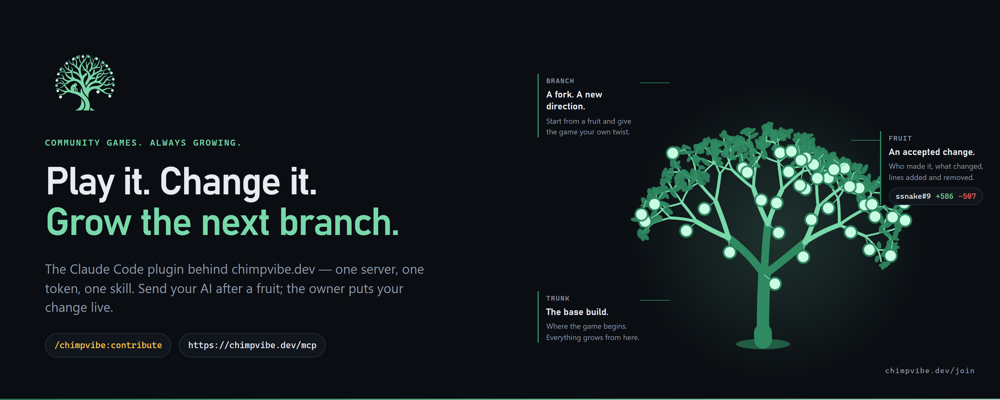

<p align="center">
  <a href="https://chimpvibe.dev/join"></a>
</p>

# chimpvibe-kit

Plugins for [ChimpVibe](https://chimpvibe.dev): resolve a game's tag, install or ask about its exact build, or contribute code through a private Draft. ChimpVibe hosts the games; members submit code for the owner to review. **Submitting does not publish or deploy a game.**

Claude Code, Cursor, and Codex install the same [`plugin/`](plugin) directory. Gemini CLI installs this repository and follows [`skills/`](skills) back to that same directory. GitHub Copilot installs [`copilot/`](copilot), whose skills are copied from that directory. The skills in [`plugin/skills/`](plugin/skills) are the shared instructions. Each client adds only its manifest, marketplace entry, and MCP settings, rendered from [`shared/`](shared) by [`scripts/platforms.mjs`](scripts/platforms.mjs). To support another client, add an adapter there and run `node scripts/render-plugins.mjs`. Leave the skill text in `plugin/skills/`.

## Connect

ChimpVibe's MCP server (`https://chimpvibe.dev/mcp`) signs you in through your browser (OAuth). **There is no token to create or paste**, and ChimpVibe refuses old fixed tokens. Every config in this kit is just the plain server URL, so each client runs its own browser sign-in. You need a ChimpVibe account with developer access turned on (chimpvibe.dev → Account → Developer). Ask your agent to read the live `chimpvibe_guide` and `tools/list` before authoring; which capabilities are advertised depends on the serving deployment.

Already set up with a token (`CHIMPVIBE_TOKEN`, an `Authorization` header, `--config "token=..."`)? See [Upgrading from the token setup](#upgrading-from-the-token-setup).

What we checked: each client's current documentation for declaring a remote MCP server and signing in with OAuth. We tested the Codex steps end to end on codex-cli 0.169.0 against a local ChimpVibe server. We did **not** install these plugins in the other clients, so their sign-in steps below follow the clients' documentation and are marked where the documentation is unclear.

### Claude

The direct setup from [chimpvibe.dev/join](https://chimpvibe.dev/join) is `claude mcp add --transport http chimpvibe https://chimpvibe.dev/mcp`, then run `/mcp` inside Claude Code and follow the browser steps (or `claude mcp login chimpvibe` from a shell). Claude Code's documentation says it starts the sign-in when a remote server answers 401 and has no `Authorization` header configured.

If you want this optional plugin's tag and contribution skills in Claude Code, install it from the marketplace, then sign in the same way:

```sh
claude plugin marketplace add burhama/chimpvibe-kit
claude plugin install chimpvibe@chimpvibe-kit
```

Then run `/mcp`, pick the chimpvibe server and sign in. If already installed, use `claude plugin update chimpvibe@chimpvibe-kit`. The plugin's [`plugin/.mcp.json`](plugin/.mcp.json) is only `type` and `url` for `https://chimpvibe.dev/mcp`; it does **not** run or bundle the site server. The canonical server source lives in ChimpVibe's `site/mcp.mjs`. You need either the plugin connection or the direct MCP connection from `/join`, not both. *(Documented for plain remote servers; the plugin path itself is not tested by us.)*

### Codex

Codex uses the same plugin directory through [`.agents/plugins/marketplace.json`](.agents/plugins/marketplace.json). Add this repository as a marketplace, install the plugin, then sign in:

```sh
codex plugin marketplace add burhama/chimpvibe-kit
codex plugin add chimpvibe@chimpvibe-kit
codex mcp login chimpvibe
```

Codex opens your browser; sign in to ChimpVibe and press **Allow**. No browser on this machine? Use `codex mcp login chimpvibe --no-browser`, open the printed address anywhere, press Allow, and paste the full address you end up on back into the terminal. Start a new Codex session afterwards (an open desktop thread keeps the old connection). [`plugin/.codex-plugin/plugin.json`](plugin/.codex-plugin/plugin.json) points at the shared skills and declares the hosted MCP as `type` and `url` only; it does not bundle a server. Use either this plugin or the direct MCP connection from `/join`, not both.

The direct setup (no plugin), tested on codex-cli 0.169.0: `codex mcp add chimpvibe --url https://chimpvibe.dev/mcp` signs you in. *(The plugin install and the plugin's own sign-in are not tested by us; if `codex mcp login chimpvibe` does not find the server, use the direct setup.)*

### Cursor

The same package is a Cursor plugin, registered by [`.cursor-plugin/marketplace.json`](.cursor-plugin/marketplace.json).

- **Team marketplace:** Dashboard → Plugins & MCPs → Add Marketplace → Import from Repo, using this repository. Install **chimpvibe**, then sign in to the chimpvibe server when Cursor asks.
- **Official marketplace:** submit `https://github.com/burhama/chimpvibe-kit` at [cursor.com/marketplace/publish](https://cursor.com/marketplace/publish). `/add-plugin` finds it only after it is listed.
- **Local check:** copy `plugin/` to `~/.cursor/plugins/local/chimpvibe` and reload the window. Cursor follows a plugin symlink only when its target is also inside `~/.cursor/plugins/local`.

[`plugin/mcp.json`](plugin/mcp.json) is only the `url` `https://chimpvibe.dev/mcp`. It does not run a local server. Cursor's MCP documentation describes OAuth sign-in (authorization code with PKCE and dynamic client registration) for remote servers; its plugin documentation does not say whether a plugin's URL-only server gets that same sign-in prompt, so **plugin sign-in is unverified**. If Cursor shows no sign-in, remove the plugin's server and add this to `~/.cursor/mcp.json` instead, then sign in from Cursor's MCP settings:

```json
{ "mcpServers": { "chimpvibe": { "url": "https://chimpvibe.dev/mcp" } } }
```

Use either this plugin or the direct MCP connection, not both.

### Gemini CLI

Gemini CLI loads [`gemini-extension.json`](gemini-extension.json) from the repository root. Install it from GitHub, restart the CLI, then sign in:

```sh
gemini extensions install https://github.com/burhama/chimpvibe-kit
```

In Gemini CLI run `/mcp auth chimpvibe`; a browser opens for sign-in (it needs a local browser). From a checkout you are editing, `gemini extensions link .` loads that checkout instead. [`skills/`](skills) points at the shared skills. The extension declares only `httpUrl` `https://chimpvibe.dev/mcp` and does not run a local server. Gemini CLI's documentation says it detects the 401 and discovers OAuth itself, but its examples use `url`, not `httpUrl`, and do not mention extensions, so **extension sign-in is unverified**. Use either this extension or the direct MCP connection from `/join`, not both.

### GitHub Copilot

GitHub Copilot in Visual Studio Code, Copilot CLI, and the Copilot app install this from [`.github/plugin/marketplace.json`](.github/plugin/marketplace.json). The plugin directory is [`copilot/`](copilot). Visual Studio Code reads that marketplace file before the Claude one.

In Visual Studio Code, add this repository under `chat.plugins.marketplaces`, then install **chimpvibe** from Extensions with `@agentPlugins`:

```json
"chat.plugins.marketplaces": ["burhama/chimpvibe-kit"]
```

In Copilot CLI:

```sh
copilot plugin marketplace add burhama/chimpvibe-kit
copilot plugin install chimpvibe@chimpvibe-kit
```

[`copilot/.mcp.json`](copilot/.mcp.json) is only `type`, `url` (`https://chimpvibe.dev/mcp`) and `tools`. It does not run a local server. Use either this plugin or the direct MCP connection, not both.

- **Visual Studio Code:** its documentation says the editor runs the OAuth flow itself and opens a browser on the first connection; it tries dynamic client registration first. Start the server and press **Allow** / sign in when asked. (Not tested by us.)
- **Copilot CLI:** GitHub's CLI command reference documents browser sign-in for remote servers that use OAuth (dynamic client registration; `/mcp auth <server-name>` starts a fresh sign-in). A GitHub issue (copilot-cli #1967, reported on an older 1.0.x build) says OAuth servers that come from a *plugin* never showed the sign-in prompt. If that happens, add the server yourself and sign in: `copilot mcp add --transport http chimpvibe https://chimpvibe.dev/mcp`, then `/mcp auth chimpvibe` in the CLI (and remove the plugin's copy). **Plugin sign-in is unverified.**
- **Copilot cloud agent:** GitHub documents that the cloud agent does **not** support remote MCP servers that use OAuth. It cannot connect to ChimpVibe; use VS Code or another client above.

## Upgrading from the token setup

Earlier versions of this kit (up to 1.6.0) and the old join page told you to set a fixed ChimpVibe token. ChimpVibe now refuses those tokens, and a client that still sends one never uses its browser sign-in. It just shows **"Auth required"** (or a 401). To fix it:

1. Remove `CHIMPVIBE_TOKEN`, `CHIMPVIBE_MEMBER` and `COPILOT_MCP_CHIMPVIBE_MEMBER` from your shell profile (`~/.zshrc`, `~/.bashrc`, `~/.profile`), from any Copilot cloud agent secret, and from your current terminal (`unset CHIMPVIBE_TOKEN`). Open a **new** terminal.
2. Remove old config entries or reinstall the plugin at 1.7.0 or newer: delete any `chimpvibe` entry that has a `bearer_token_env_var`, an `Authorization` header or `--config "token=..."`, then reinstall (`claude plugin update chimpvibe@chimpvibe-kit`, `gemini extensions update chimpvibe`, or remove and add the plugin in Cursor, Codex and Copilot).
3. Sign in again, using the steps for your client above.

For **Codex** (tested on codex-cli 0.169.0):

```sh
codex --version                  # update Codex first if it is old
codex mcp list                   # Auth "Bearer token" on the chimpvibe row is the problem
codex mcp logout chimpvibe
codex mcp remove chimpvibe
unset CHIMPVIBE_TOKEN
```

If you installed the kit plugin, remove it too (`codex plugin remove chimpvibe@chimpvibe-kit`; command taken from Codex's source, not tested by us). Open `~/.codex/config.toml` and any `.codex/config.toml` in your project folders, and delete every `[mcp_servers.chimpvibe]` block and any line containing `CHIMPVIBE_TOKEN` or `Authorization = "Bearer ...`. Then add ChimpVibe again and sign in:

```sh
codex mcp add chimpvibe --url https://chimpvibe.dev/mcp
codex mcp login chimpvibe        # only if the browser did not open
codex mcp list                   # chimpvibe should show Auth: OAuth and no Bearer Token Env Var
```

Quit Codex completely and start a **new** thread, then type `/mcp`: `chimpvibe` should be listed with its tools. Never send anyone your `~/.codex/.credentials.json`, a token value, or anything that starts with `Bearer`.

## Troubleshooting

- **"Auth required."** (Codex), a 401, or "Old ChimpVibe tokens no longer work": your client is still sending an old fixed token, so the browser sign-in is never used. Follow [Upgrading from the token setup](#upgrading-from-the-token-setup). Check that the client's chimpvibe entry has only the URL: no token variable, no `Authorization` header.
- Signed in but no tools: start a new session or thread, and check that your ChimpVibe account has developer access turned on.

## One tag, three doors

An accepted build has a tag like `chimpvibe:<slug>#<n>`. Paste it to your agent; the [`tag` skill](plugin/skills/tag/SKILL.md) calls `chimpvibe_resolve`, offers Install / Ask / Modify, and follows the returned actions. A tag identifies one build, **not necessarily the build now serving players**.

| Door | What happens |
| --- | --- |
| **Install** | Historical legacy nodes provide a SHA-256-checked ZIP and local server. Published native revisions provide a verified `.gepkg` package and runner; the runner requires Node >= 22.13 and OS isolation (macOS sandbox or Linux Docker). An unpublished native revision has no public package URL and requires member access via `chimpvibe_read_package`. Follow the exact record rather than assuming all tags are ZIPs. |
| **Ask** | Read that build's own verified ZIP/package or member-accessible native package, then cite its actual source. |
| **Modify** | Only an **admitted native revision** can start a Draft. A historical legacy tag remains installable/readable, not writable. The returned action names the exact revision; if Modify is unavailable, the skill explains why rather than changing bases. |

A published tag can also be resolved without signing in at `https://chimpvibe.dev/api/tag/<URL-encoded-tag>`; private native revisions and authoring require a signed-in MCP connection. The public endpoint cannot submit a Draft.

## Contribute a change or start a game

The [`contribute` skill](plugin/skills/contribute/SKILL.md) uses the live guide instead of a fixed list of engine tools:

1. Call `chimpvibe_whoami`, `chimpvibe_guide`, and current `tools/list` (after resolving a pasted tag). For an existing admitted native Game, select an **accepted native revision** using `chimpvibe_games` and `chimpvibe_tree`, or keep the exact revision returned by `chimpvibe_resolve`. `head` is serving, while `latestAccepted` may be different. `chimpvibe_fork_from` returns the precise `chimpvibe_begin_draft` arguments.
2. For a **brand-new independent Game**, use `chimpvibe_new_game` if advertised. It creates a private root Draft and is **never** a fork of the nearest existing game. If new-game admission is closed, wait rather than putting a new game in someone else's tree. Links are not game submissions.
3. Inspect the private Draft and edit under `game/` using the advertised `chimpvibe_draft_*` tools or the verified authoring helpers. Preserve the server-issued `id` and `gameId` in `game/manifest.json`. Use a fresh `requestKey` for each new keyed mutation; reuse a key only for its exact retry. `chimpvibe_draft_receipt` and `chimpvibe_draft_status` reconcile ambiguous replies. The live `chimpvibe_guide` describes the source policy, design rules, hashes, bootstrap, import/export and isolated runner.
4. Validate the **current** bytes, preview separately when gameplay needs checking, and attach a real running-game screenshot for a new Game. Validation alone is not a playtest. `chimpvibe_draft_submit` submits the validated Draft for owner review. **Stop there**—do not publish, deploy, push, or submit twice.

A submission is not a serving revision. The owner decides whether to accept/deploy; serving can differ from the latest accepted revision. Later, `chimpvibe_whoami.submissions.native` distinguishes Draft status from current serving state, and `chimpvibe_my_submissions` shows the member's own work.

## What's in this repository

- `shared/plugin-meta.json` and `shared/connection.json`: plugin identity and the hosted MCP connection. These are the records a new client adapter reads.
- `scripts/platforms.mjs` and `scripts/render-plugins.mjs`: render each client's manifest, marketplace entry, and MCP config. `node scripts/render-plugins.mjs --check` fails if a generated file drifts.
- `plugin/skills/`: tag and contribute skills. This is the authored copy.
- `plugin/.claude-plugin/` and `plugin/.mcp.json`: Claude Code manifest and the plain server URL.
- `plugin/.cursor-plugin/` and `plugin/mcp.json`: Cursor manifest and the plain server URL.
- `.agents/plugins/marketplace.json` and `plugin/.codex-plugin/`: Codex marketplace and manifest (plain server URL; sign in with `codex mcp login chimpvibe`).
- `gemini-extension.json` and `skills/`: Gemini CLI extension (plain `httpUrl`). `skills/` links to `plugin/skills/`.
- `.github/plugin/marketplace.json` and `copilot/`: GitHub Copilot marketplace and plugin (plain server URL). `copilot/skills/` is generated from `plugin/skills/`.
- `scripts/check-secrets.mjs`: scan the checkout for secret-shaped content.
- `art/banner.png`: homepage banner.

The kit has no local MCP server implementation. Read the live `chimpvibe_guide` for the serving build's contract, not cached instructions or an older server source copy. Clients prefix MCP tool names differently; call the ChimpVibe tools the client actually discovers.

MIT.
